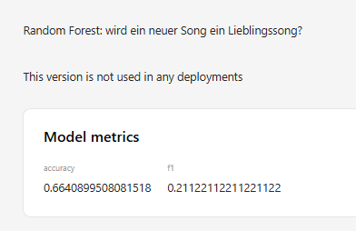
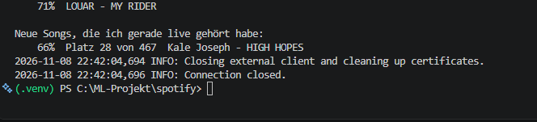
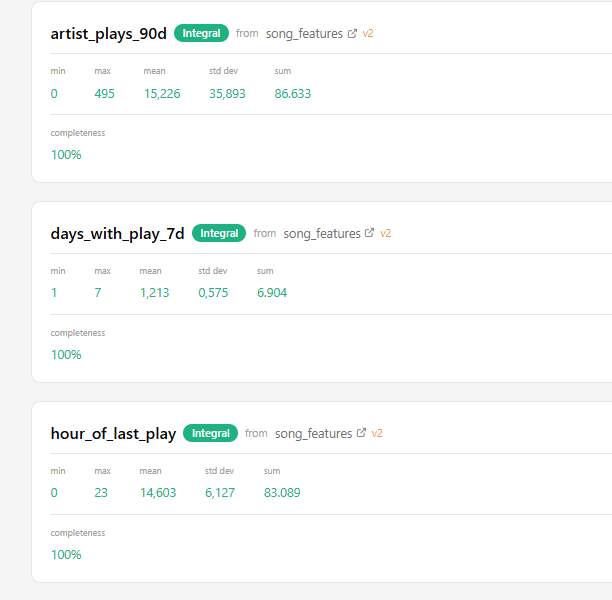
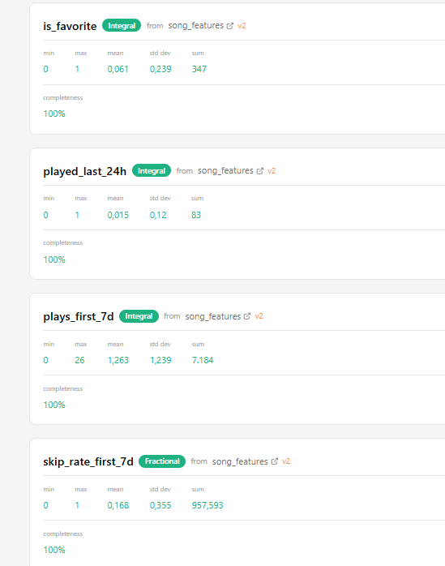

# PreWrapped

Projektarbeit MLOps – Leandro Lopes – CAS AI Operations

---

## Worum geht es im Projekt?

Spotify Wrapped zeigt einem Ende Jahr, was man am meisten gehört hat. Ich wollte das umdrehen:
Wenn ich einen neuen Song entdecke, soll mein Modell nach einer Woche sagen, ob der Song bei mir hängen bleibt.

**Was wird vorhergesagt (Label `is_favorite`):**
Ein neuer Song ist ein Lieblingssong, wenn ich ihn **nach der ersten Woche (Tag 7 bis 30) noch mindestens 2 Mal** höre.

- Die Vorhersage kommt **7 Tage** nach dem ersten Mal hören.
- Ein Play zählt nur ab **30 Sekunden**, sonst gilt er als geskippter Song.
- Songs aus den ersten 30 Tagen von meinem Verlauf lasse ich weg, weil ich die vielleicht schon vorher kannte.

Am Anfang hatte ich "mindestens 10 Plays in Tag 0 bis 30". Das hat nicht funktioniert:
- Mit 10 Plays waren nur 0.7 % der Songs Lieblingssongs, zu wenig zum Lernen.
- Mit "Tag 0 bis 30" war jeder Song mit vielen Plays in der ersten Woche automatisch ein Lieblingssong.
  Das Label steckte also schon in den Features (Data Leakage). Darum zähle ich jetzt nur Tag 7 bis 30,
  also nur was **nach** der Vorhersage passiert.

## Daten

| Daten | Wofür | Zeitraum |
|---|---|---|
| **Spotify Datenexport** (Kontodaten, `StreamingHistory_music_*.json`) | historische Daten für Features und Training | 25.10.2025 bis 28.10.2026 |
| **Spotify Web API** (zuletzt gehörte Songs, live) | aktuelle Daten für die Inferenz | die letzten 50 Plays |
| **Erweiterter Streamingverlauf** (`Streaming_History_Audio_*.json`) | nur zum Überprüfen der Vorhersage (kam erst später dazu) | bis 05.11.2026 |
| **Beispieldaten** (`data/sample/`, erfunden mit `src/beispieldaten_erstellen.py`) | zum Ausprobieren ohne eigene Spotify-Daten | 1 Jahr, erfunden |

Mein Verlauf in Zahlen:

| | |
|---|---|
| Plays | 38'522 (ca. 105 pro Tag) |
| Stunden Musik | 1'533 |
| Verschiedene Songs / Artists | 10'050 / 3'487 |
| Neue Songs mit Features (nach den ersten 30 Tagen) | 7'923 |
| Davon mit fertigem Label (30 Tage vorbei) = Trainingsdaten | 7'113 |
| Davon Lieblingssongs | 439 (6 %) |

Meine echten musik Daten sind nicht auf GitHub, weil das meine private Daten sind (`data/raw/` steht in der `.gitignore`).
Wenn in `data/raw/` keine Daten liegen, nimmt die Feature Pipeline automatisch die Beispieldaten.

## Features

Alle Features werden in `src/features.py` berechnet. Die Feature Pipeline und die Inferenz brauchen
die gleichen Funktionen und gleiche Liste `FEATURE_SPALTEN`, damit die Features immer gleich
berechnet werden (kein Training-Serving Skew).

| Feature | Art | Was es ist |
|---|---|---|
| `plays_first_7d` | aggregiert | Wie oft ich den Song in der ersten Woche richtig gehört habe (ab 30 Sek.) |
| `skip_rate_first_7d` | aggregiert | Anteil geskippte Plays in der ersten Woche |
| `days_with_play_7d` | aggregiert | An wie vielen Tagen der ersten Woche ich ihn gehört habe |
| `artist_plays_90d` | aggregiert | Wie oft ich den Artist in den 90 Tagen **vor** dem neuen Song gehört habe ("kenne ich den Artist?") |
| `played_last_24h` | RT | Habe ich den Song in den letzten 24 Stunden gehört? (bei der Inferenz mit den Live-Daten von Spotify) |
| `hour_of_last_play` | RT | Uhrzeit vom letzten Play in Schweizer Zeit (bei der Inferenz mit den Live-Daten von Spotify) |

- **Aggregiert** = fasst viele Plays über die erste Woche zu einer Zahl zusammen. Das kann man vorher berechnen und im Featurestore speichern.
- **RT** = beschreibt den Moment der Vorhersage. In der Inferenz Pipeline werden diese Werte mit den Live-Daten von Spotify überschrieben, wenn ich den Song gerade gehört habe.
- **Primary Key:** `song_id` = "Artist - Titel". **Event Time:** `first_played_at` = erstes Mal gehört.

## Modell

**Random Forest** von scikit-learn (100 Entscheidungsbäume, `max_depth=5`).
Ich habe ihn genommen, weil er einfach ist, gut mit wenigen Features funktioniert und zeigt, welche Features wichtig sind.

Weil nur 6 % der Songs Lieblingssongs sind, verwende ich `class_weight="balanced"`.
Sonst lernt das Modell einfach "immer nein" und liegt trotzdem zu 94 % richtig.

**Resultat auf den Testdaten (20 %):**

| | Accuracy | F1-Score |
|---|---|---|
| Einfache Regel "nie Lieblingssong" (Baseline) | 0.93 | 0.00 |
| **Mein Random Forest** | **0.66** | **0.21** |

Die Accuracy ist bei so seltenen Lieblingssongs nicht aussagekräftig. Die Baseline hat 93 %, findet aber keinen
einzigen Lieblingssong. Darum schaue ich auf den F1-Score: Das Modell findet einen Teil der Lieblingssongs,
liegt aber oft daneben. Es ist schwach, aber besser als die Baseline.

**Wichtigste Features:** `plays_first_7d` (32 %), `artist_plays_90d` (23 %), `days_with_play_7d` (21 %),
`hour_of_last_play` (12 %), `skip_rate_first_7d` (9 %), `played_last_24h` (3 %).
Spannend: Bei Artists, die ich schon kenne, bleiben neue Songs eher hängen.



## Aufbau (die 3 Pipelines)

```
1 Feature Pipeline:   Spotify Export   ──► Feature Group "song_features" (Hopsworks)
2 Training Pipeline:  Feature Group    ──► Feature View ──► Modell ──► Model Registry (Hopsworks)
3 Inferenz Pipeline:  Spotify API live + Feature View + Model Registry ──► Top 10 neue Songs mit Chance
```

**1. Feature Pipeline** – `pipelines/1_feature_pipeline.py`
1. Lädt meinen Spotify Verlauf aus `data/raw/`
2. Berechnet pro Song die Features und das Label (`src/features.py`)
3. Erstellt die Feature Group `song_features` mit Primary Key `song_id` und Event Time `first_played_at`
4. Fügt die Tabelle in Hopsworks ein

**2. Training Pipeline** – `pipelines/2_training_pipeline.py`
1. Lädt die Feature Group
2. Erstellt die Feature View mit den 6 Features und dem Label
3. Erstellt das Training Dataset mit `train_test_split` in Hopsworks (80/20). Mit `extra_filter` kommen nur
   Songs mit fertigem Label rein (30 Tage vorbei)
4. Trainiert den Random Forest und vergleicht ihn mit der Baseline
5. Speichert das Modell lokal mit `joblib` und lädt es in die Hopsworks Model Registry (mit Metriken und Feature View)

**3. Inferenz Pipeline** – `pipelines/3_inference_pipeline.py`
1. Holt live meine letzten 50 Plays von der Spotify API
2. Holt über die Feature View die Features von allen Songs, die ich in den letzten 30 Tagen entdeckt habe
   Die RT-Features werden mit den Live-Daten aktualisiert
3. Lädt die neueste Modell-Version aus der Model Registry
4. Macht die Vorhersage und zeigt die Top 10

## So bringt man es zum Laufen

**Was man braucht:**
- Python 3.13 (Hopsworks braucht Python unter 3.14)
- Einen Hopsworks Account mit einem Projekt und einem API-Key
- Spotify Premium und eine App im Spotify Developer Dashboard
  (Redirect URI `http://127.0.0.1:8888/callback`, API: Web API)

```powershell
# 1. Repo holen
git clone https://github.com/leeloppes/prewrapped.git
cd prewrapped

# 2. Umgebung erstellen und Pakete installieren
python -m venv .venv
.venv\Scripts\Activate.ps1
pip install -r requirements.txt

# 3. Keys eintragen
#    .env.example kopieren, in .env umbenennen und die eigenen Keys eintragen

# 4. Optional: Verbindungen testen
python test_verbindungen.py
```

**Auf Windows:** zuerst den Ordner `C:\tmp` erstellen (`mkdir C:\tmp`), sonst kann Hopsworks keine Daten hochladen (siehe Schwierigkeiten).

**Daten:** Den eigenen Spotify Export (Kontodaten) anfordern und die Dateien `StreamingHistory_music_*.json`
nach `data/raw/` kopieren. Ohne eigene Daten werden die Beispieldaten aus `data/sample/` verwendet.

**Pipelines in dieser Reihenfolge ausführen:**

```powershell
python pipelines/1_feature_pipeline.py
python pipelines/2_training_pipeline.py
python pipelines/3_inference_pipeline.py
```

## Resultat

So sah die Vorhersage am 05.11.2026 aus (Songs, die ich zwischen 6. und 21. Oktober entdeckt habe):

```
PreWrapped - meine neuen Songs mit dem meisten Lieblingssong-Potenzial:
    78%  Lithe - For What (feat. Cash Cobain)
    78%  Lithe - Leaning
    75%  Loe Shimmy - Seduce You
    74%  Kale Joseph - HIGH HOPES
    74%  Josh Levi - EGO
    74%  Don Toliver - ROCKSTAR GIRL
    73%  SAHXL - KIAEESHA
    73%  Josh Levi - VICES
    73%  Quavo - Backwards (feat. T.I.)
    73%  Loe Shimmy - Bag Rite
```

Die Prozente sind wegen `class_weight="balanced"` zu hoch. Wichtig ist vor allem die Reihenfolge.

**Überprüfung (Backtest):** Später kam noch mein erweiterter Streamingverlauf (Daten bis 05.11.2026).
Damit konnte ich nachschauen, ob die Songs wirklich hängen geblieben sind:

| | |
|---|---|
| Neue Songs aus dem Oktober | 579 |
| Wirklich hängen geblieben (mind. 2 Plays nach der ersten Woche) | 6 (1 %) |
| Bei den Top 10 % vom Modell hängen geblieben | 0 % |
| Beim Rest | 1.1 % |

Das Modell hat im Oktober also nicht getroffen. Die Songs, die wirklich hängen geblieben sind
(z.B. Travis Scott - CAN'T SAY), hatte es weit hinten. Gründe siehe Limitationen.


**Test mit den Live-Daten (RT-Features):** Am 08.11.2026 habe ich "HIGH HOPES" von Kale Joseph
nochmals gehört und direkt danach die Inferenz Pipeline gestartet. Die Pipeline hat den Song in den
Live-Daten von Spotify gefunden ("davon 1 gerade live gehört") und die RT-Features aktualisiert:

| | Chance | Platz |
|---|---|---|
| 05.11. (nicht gerade gehört) | 74 % | 4 |
| 08.11. (gerade live gehört) | 66 % | 28 von 467 |

Damit sieht man, dass die Live-Daten wirklich in die Vorhersage einfliessen. Aber Achtung: Dazwischen habe
ich das Modell neu trainiert (Version 3 → 4). Ein Teil vom Unterschied kann auch vom neuen Modell kommen.
Ich wollte auch "EGO" testen, aber den Song hatte ich am 7.10. entdeckt, und am 8.11. war er schon
nicht mehr in den letzten 30 Tagen.




Zum Vergleich, meine meistgehörten Songs im ganzen Jahr (einfach gezählt, wie bei Wrapped):
1. Van Zee - Amar De Cor (74x)
2. Diddy - Another One Of Me (feat. 21 Savage) (70x)
3. Jack Harlow - Prague (69x)

Statistiken der Features in Hopsworks:




## Schwierigkeiten

- **Hopsworks Version:** Zuerst hatte ich Version 5.2.1 installiert, der Server läuft aber auf 5.1.
  Es kam eine Warnung → ich habe die passende Version 5.1.2 installiert.

- **Hopsworks auf Windows (3 Probleme):** Hopsworks ist vor allem für Linux und Mac gemacht.
  Auf Windows hatte ich drei Fehler:
  1. Beim Login wollte Hopsworks Zertifikate im Ordner `/tmp` speichern. Den gibt es auf Windows nicht standard
     → Fehler "Pfad nicht gefunden". Lösung: mit `cert_folder` einen eigenen Ordner im Projekt angeben.
  2. Beim Erstellen der Feature Group: Das Standard-Format "DELTA" braucht eine Bibliothek,
     die es nur für Linux/Mac gibt. Lösung: `time_travel_format="HUDI"` verwenden.
  3. Beim Hochladen schreibt Hopsworks nochmals Dateien nach `/tmp`, diesmal fest im Code
     (ignoriert `cert_folder`). Lösung: Ordner `C:\tmp` von Hand erstellen (`mkdir C:\tmp`).

- **Warten nach der Feature Pipeline:** Nach dem Hochladen schreibt Hopsworks die Daten mit einem Job
  im Hintergrund in die Tabelle (ca. 2 - 5 Minuten). Hab ich die Training Pipeline zu früh gestartet, kam
  "Could not read data using Hopsworks Query Service". Lösung: warten, bis der Job unter "Jobs" fertig ist.

- **Primary Key umbenannt:** Bei `get_batch_data` heisst die Spalte `song_id` plötzlich anders
  (Hopsworks schreibt den Tabellennamen davor, weil sie kein Feature ist). Lösung: Spalte suchen und umbenennen.

- **Spotify API 2026:** Spotify hat viele Funktionen für Entwickler gesperrt
  (z.B. Tempo, Tanzbarkeit, Beliebtheit von Songs). Darum nutze ich nur mein Hörverhalten.

- **Spotify Redirect URI:** Muss `http://127.0.0.1:8888/callback` sein, `localhost` wird nicht mehr akzeptiert.

- **Zeitzone:** Die Spotify API gibt die Zeit in UTC zurück (z.B. 10:20 statt 12:20 bei uns).
  Muss man bei Features wie der Uhrzeit beachten.

## Was nicht so gut geht (Limitationen)

- **Das Modell ist schwach.** F1 nur 0.21, und im Backtest hat es nicht getroffen. Ob ein Song hängen bleibt,
  hängt von vielem ab, das nicht in den Daten ist.
- **Ich höre sehr breit.** 69 % der neuen Songs höre ich im ersten Monat nur einmal. Lieblingssongs sind darum
  sehr selten (6 %), und in der ersten Woche gibt es kaum Unterschiede zwischen den Songs.
- **Data Drift:** Im Training waren 6 % Lieblingssongs, im Oktober nur 1 %. Mein Hörverhalten ändert sich,
  das Modell müsste regelmässig neu trainiert werden.
- **Nur 50 Live-Plays:** Die Spotify API gibt nur die letzten 50 Plays zurück (bei mir ca. ein halber Tag).
  Für die aggregierten Features (erste Woche) braucht es darum den Export, und der kommt nur auf Anfrage
  und mit Verzögerung. Ein ganz neuer Song bekommt erst nach 7 Tagen eine Vorhersage.
- **RT-Features haben wenig Einfluss** (zusammen ca. 15 %) und im Training sind sie nur eine Annäherung
  (Zustand am Tag 7, nicht "jetzt").
- **Skips sind geschätzt:** Im einfachen Export steht nicht, ob geskippt wurde. Ich nehme "unter 30 Sekunden".
- **Song-ID ist "Artist - Titel":** Der einfache Export hat keine Spotify-ID. Gleicher Song mit anderer
  Schreibweise zählt als zwei Songs.
- **Zufälliger 80/20 Split** statt nach Zeit. Ein Split nach Zeit (alt trainieren, neu testen) wäre ehrlicher.
- **Nur meine Daten:** Das Modell passt nur zu meinem Hörverhalten.

## Ausblick

- Mit dem **erweiterten Streamingverlauf** neu trainieren: mehrere Jahre Daten, echte Skip-Info und Spotify-IDs.
- Die Feature Pipeline regelmässig laufen lassen und Live-Plays sammeln, damit man nicht auf den Export warten muss.
- Eine Spotify-Playlist "Next Favorites" automatisch mit den Top 10 füllen.
- Im Dezember mit meinem echten Spotify Wrapped 2026 vergleichen.

## Projektstruktur

```
data/raw/            meine echten Spotify Daten (nicht auf GitHub)
data/sample/         erfundene Beispieldaten
pipelines/           die 3 Pipelines (Feature, Training, Inferenz)
src/features.py      Berechnung der Features und des Labels (von allen Pipelines benutzt)
src/beispieldaten_erstellen.py   erstellt die Beispieldaten
notebooks/           mein Notebook zum Daten anschauen und Features verstehen
docs/                Screenshots aus Hopsworks
test_verbindungen.py testet die Verbindung zu Hopsworks und Spotify
requirements.txt     Python Pakete (Python 3.13)
.env.example         Vorlage für die Keys
```
